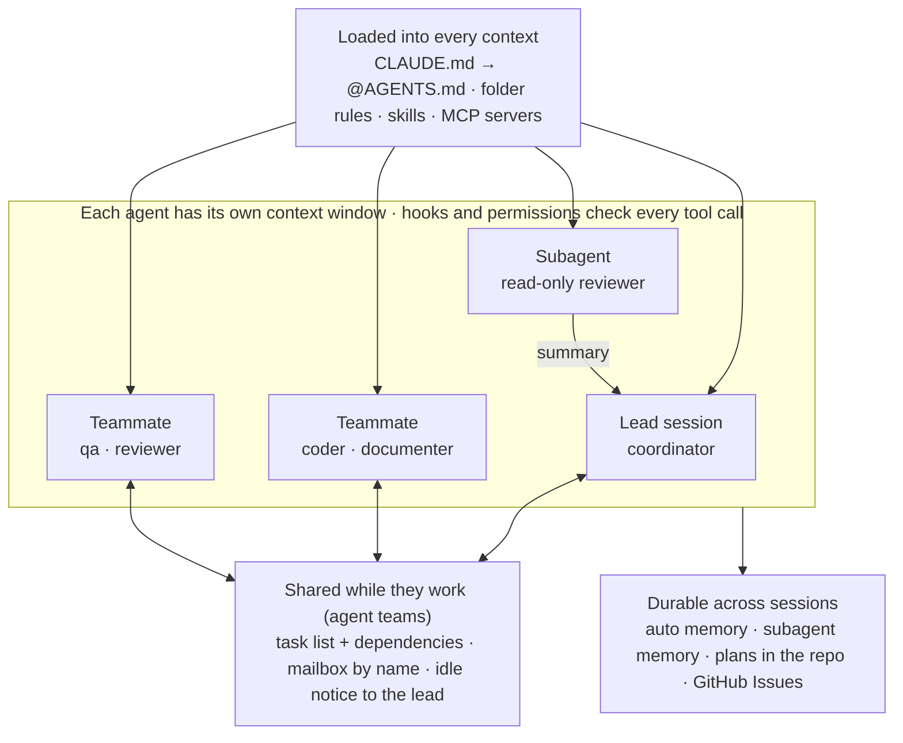
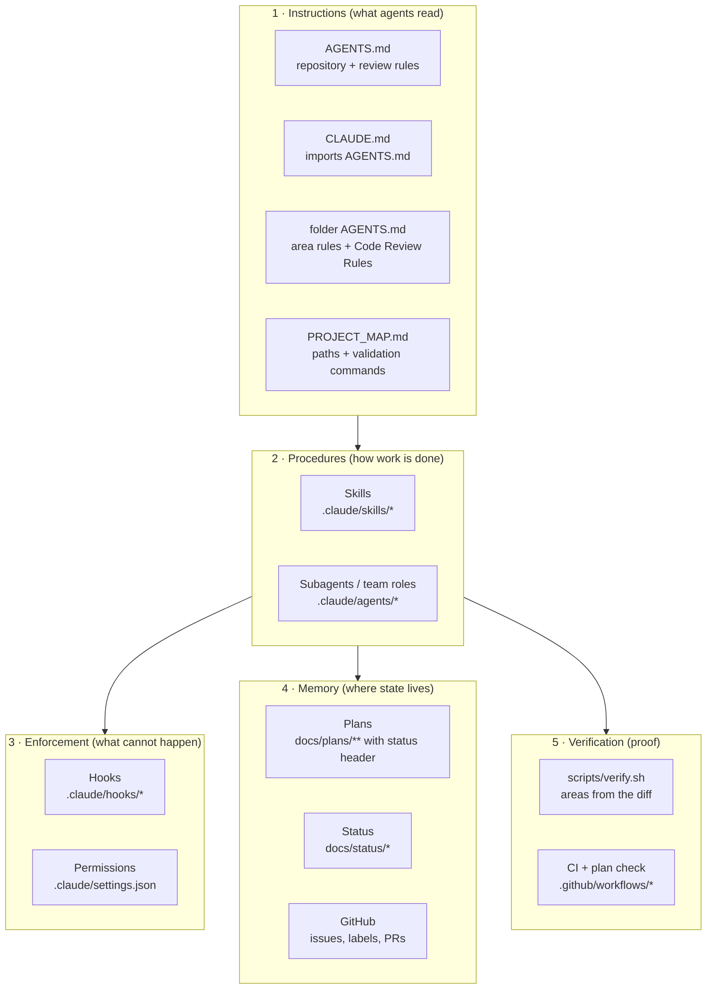
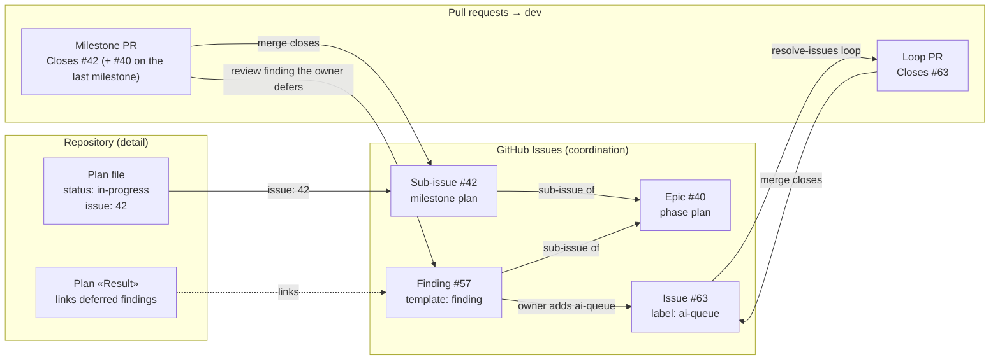
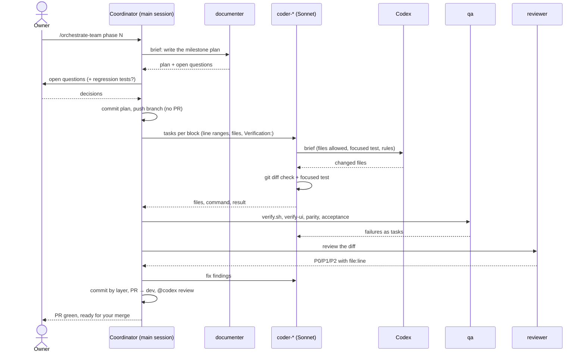
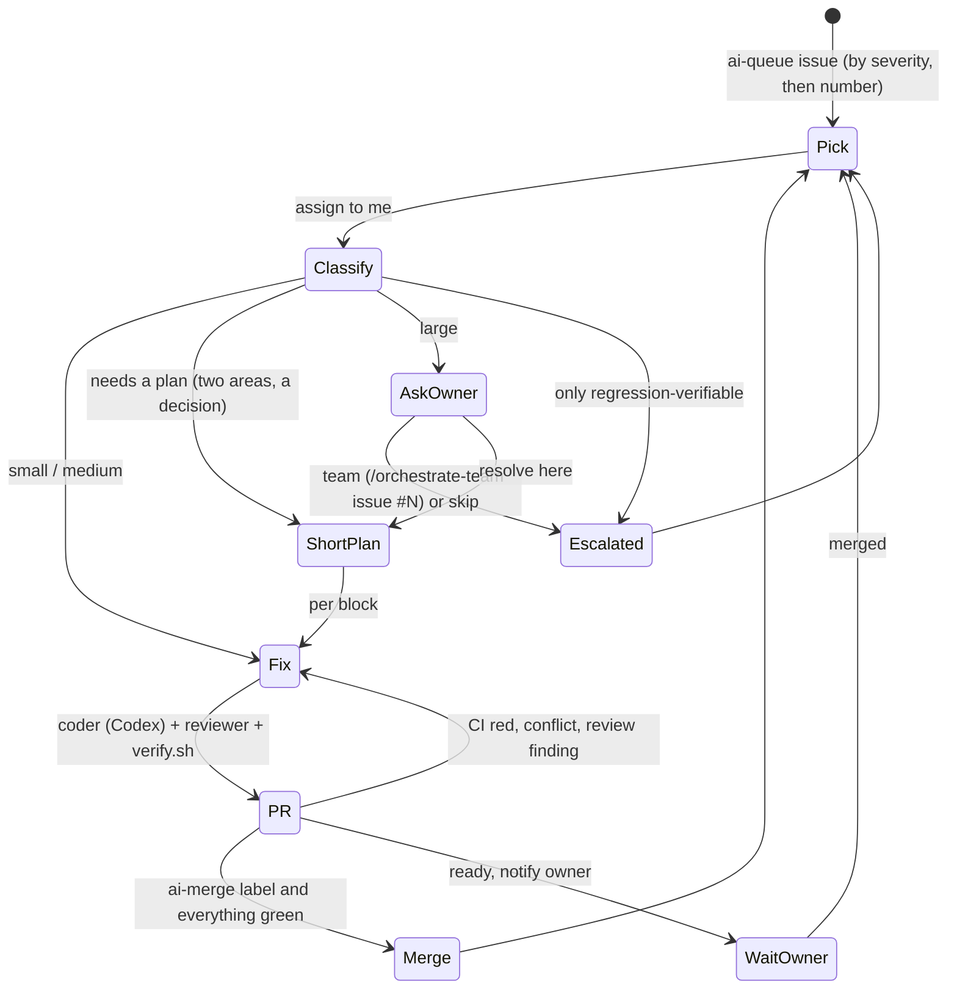

# How this agent harness works

This document explains, for people, how the harness in this repository, **with [Claude Code](https://code.claude.com/docs) and [Codex](https://learn.chatgpt.com/docs/agent-configuration/subagents) entry points**, turns AI coding agents into a predictable team: what each piece does, how a piece of work flows from an idea to a merged PR, where humans decide, and how to adapt it to your project. The rules the agents themselves follow live in [`AGENTS.md`](AGENTS.md). For a visual version, open [`docs/site/index.html`](docs/site/index.html) (landing page with animated diagrams) or the slide deck [`docs/site/presentation.html`](docs/site/presentation.html) to present it to a team.

## 1. What a harness is, and why

A coding agent on its own is a capable but forgetful contractor: it does not remember yesterday's decisions, it does not know your branch policy, it happily edits a generated file, and it will claim "all tests pass" if nothing forces it to show the command. A **harness** is everything around the model that makes its work repeatable and safe:

| Problem with bare agents | What the harness does |
|---|---|
| Forgets context between sessions | **The repository is the memory:** plans with a status header, a generated status page, and a hook that injects the current branch, PR and active plans at session start. |
| Ignores team conventions | **One rule file** (`AGENTS.md`) read by every agent (Claude Code and Codex), plus one per folder. |
| "Follows" rules only when it remembers them | **Hooks** enforce the critical rules mechanically (no commits to `main`, no editing generated files, subagents cannot push). |
| Inconsistent output | **Skills** turn recurring workflows (plan, branch, close, review) into fixed procedures with fixed output. |
| One context does everything and gets expensive | **Subagents and teams** split work into narrow roles with their own context and cheaper models. |
| Reviews its own work | **Separation of duties:** Codex writes the code, Claude reviews it, a person merges. |
| Unverified claims | **One validation entry point** (`scripts/verify.sh`) used by agents and CI alike; skipped checks are reported, never silent. |
| Work and findings get lost in chat | **GitHub Issues is the coordination backbone:** every plan has an issue (epics and sub-issues), every deferred finding becomes an issue, PRs close them, and labeled issues are a work queue agents resolve on their own (section 4). |

The design goal is that a person only has to step in for **decisions** (scope, approvals, merges), never for **enforcement**.

> **The two pillars.** The repository holds the *detail* (plans, rules, status) and **GitHub Issues holds the *coordination*** (what exists, who is on it, what is open, what closed it). Agents read and write both; neither one duplicates the other.

## 2. Claude Code and Codex

The team workflow runs in either client. Claude Code uses Agent Teams or its subagents. Codex uses native subagents. Both use the same plan, branch and PR for handoff. Choose which client coordinates and [configure its models](docs/guides/CONFIGURE_AGENTS.md). The diagram and table below illustrate the Claude Code setup, including its separate scheduled issue loop.



| Claude Code feature | What it provides | What the harness builds on it |
|---|---|---|
| [Project memory](https://code.claude.com/docs/en/memory) | `CLAUDE.md` loaded at the start of every session, subagent and teammate; `@imports`; files in subfolders loaded when Claude works there | `CLAUDE.md` → `@AGENTS.md` at the root and in every folder: one source of rules for Claude and Codex |
| [Auto memory](https://code.claude.com/docs/en/memory) | Notes Claude writes itself (a `MEMORY.md` index); its first lines load each session; it lives on one machine | Because it is per machine, decisions the whole team must follow go to `AGENTS.md` («Owner criteria») |
| [Skills](https://code.claude.com/docs/en/skills) | `SKILL.md` procedures triggered by their description or by `/name` | The Claude skills (section 3.2) |
| [Subagents](https://code.claude.com/docs/en/sub-agents) | Own context window, tools, model and optional persistent memory; only a summary returns | The 7 roles; reviewers limited to `Read, Grep, Glob` (section 3.3) |
| [Agent teams](https://code.claude.com/docs/en/agent-teams) | Teammates load the project context (CLAUDE.md, skills, MCP servers), share a task list with dependencies and file-locked claims, message each other by name; the lead is notified when one goes idle | `/orchestrate-team`, its briefs and the `task-gate` hook (section 6) |
| [Hooks](https://code.claude.com/docs/en/hooks) | Lifecycle events (`SessionStart`, `PreToolUse`, `TaskCreated`, `TaskCompleted`, `TeammateIdle`…); exit code 2 blocks with feedback; `onFailure` can make them fail closed | The 5 hooks (section 3.4) |
| [Permissions and settings](https://code.claude.com/docs/en/permissions) | A versioned `.claude/settings.json` with allow and deny rules, environment and options | Denied protected pushes, the agent teams flag, the one-hour prompt cache (section 3.5) |
| [Plugins](https://code.claude.com/docs/en/plugins) | Installable bundles of skills, agents, hooks and MCP servers from a marketplace | The Codex plugin (`codex:codex-rescue`) that coders delegate code to |
| `/loop` | Re-runs a prompt or a skill at its own pace until the work is done | `/loop /resolve-issues` works the issue queue (section 7) |

**Versions.** Agent teams are experimental (enabled by `CLAUDE_CODE_EXPERIMENTAL_AGENT_TEAMS=1` in `.claude/settings.json`). Fail-closed hooks need Claude Code v2.1.295 or later and the one-hour cache v2.1.242 or later; older versions ignore those fields and the harness works as before.

## 3. The building blocks



### 3.1 Instructions

| File | Read by | Purpose |
|---|---|---|
| [`AGENTS.md`](AGENTS.md) | Every agent, every session | Repository rules (branches, plans, findings, tests), owner criteria and the root **Code Review Rules**. The single source of truth. |
| [`CLAUDE.md`](CLAUDE.md) | Claude Code | One line: `@AGENTS.md`. Claude and Codex never drift apart. |
| `<folder>/AGENTS.md` (+ `<folder>/CLAUDE.md` with `@AGENTS.md`) | Agents working in that folder, and reviewers | Area-specific rules and the area's **Code Review Rules** (what counts as P0/P1 there). The one-line `CLAUDE.md` makes Claude Code load it in every version (it reads a nested `AGENTS.md` on its own only from v2.1.277). |
| [`PROJECT_MAP.md`](PROJECT_MAP.md) | Agents before changing anything | Where things are and how to validate them. Short on purpose. |

Rules are written as **mandatory statements with the reason and the correct alternative**, so an agent that is blocked knows what to do instead.

### 3.2 Skills (procedures)

A skill is a Markdown file with a `description` (when to trigger) and numbered steps. Claude Code loads it when the description matches the request, or when the user types `/<skill>`.

| Skill | Trigger | What it guarantees |
|---|---|---|
| [`onboarding`](.claude/skills/onboarding/SKILL.md) | New machine, "set up the environment" | Summary of the repo read from the sources, a read-only environment check (`check.sh`), installs only with confirmation. |
| [`feature-plan`](.claude/skills/feature-plan/SKILL.md) | "Write the plan", before any feature | Same plan structure every time (status, owner decisions, design, blocks with owner and `Verification:`, tests, closing criteria, risks), a thin GitHub issue, plan link delivered. |
| [`new-branch`](.claude/skills/new-branch/SKILL.md) | Starting work, after a merge | Clean branch from an up-to-date `dev`; never carries someone's uncommitted work silently. |
| [`close-increment`](.claude/skills/close-increment/SKILL.md) | "Close the milestone", "open the PR" | Validation with real numbers, «Result» section in the plan, status updated, PR against `dev` with what was **not** verified, Codex review requested. |
| [`orchestrate-team`](.claude/skills/orchestrate-team/SKILL.md) | `/orchestrate-team <plan \| issue #N \| PR #N>` | A coordinated agent team that takes a milestone to a green, reviewed PR. |
| [`configure-agents`](docs/guides/CONFIGURE_AGENTS.md) | Choose models for the coordinator and roles | Updates native model settings from either client. |
| [`resolve-issues`](.claude/skills/resolve-issues/SKILL.md) | `/loop /resolve-issues` | A self-paced loop that resolves `ai-queue` issues one PR at a time. |
| [`verify-ui`](.claude/skills/verify-ui/SKILL.md) | "Verify the screen" | Evidence from a running UI (screenshots, texts read from the screen, console and network). |
| [`reference-parity`](.claude/skills/reference-parity/SKILL.md) | "Does it match the reference?" | A table of text/order/rule differences against the project's functional reference app. |

### 3.3 Subagents and team roles

Each file in `.claude/agents/` defines a role: its tools, its model and its instructions. Two families:

**Read-only reviewers** (`tools: Read, Grep, Glob`, they cannot break anything):

| Subagent | Reviews |
|---|---|
| [`db-security-reviewer`](.claude/agents/db-security-reviewer.md) | Migrations, access policies, privileged functions, tenant isolation, denied-path tests. |
| [`contract-reviewer`](.claude/agents/contract-reviewer.md) | Shared schemas and fixtures: backward compatibility, valid/invalid examples, client conformance. |
| [`reference-explorer`](.claude/agents/reference-explorer.md) | Finds the origin of a screen or rule in the reference app and returns exact paths and texts. |

**Team roles** (they edit or run things, but never touch git history):

| Role | Owns | Never |
|---|---|---|
| [`documenter`](.claude/agents/documenter.md) | `docs/**`, `PROJECT_MAP.md`, `HARNESS.md`, `AGENTS.md` files | Code, tests, commits. |
| [`coder`](.claude/agents/coder.md) (`coder-backend`, `coder-web`, `coder-mobile`) | Its area’s files. Implements directly in Codex or uses the optional bridge in Claude, then verifies | Commits, editing outside its area, fixing by hand while Codex is available, reviewing its own work. |
| [`qa`](.claude/agents/qa.md) | Acceptance tests and evidence | Fixing production code; regression tests without permission. |
| [`pr-reviewer`](.claude/agents/pr-reviewer.md) | The review (P0/P1/P2 with `file:line`) | Editing, running tests. |

How to use them, read their reports and write new ones: [`docs/guides/SUBAGENTS.md`](docs/guides/SUBAGENTS.md).

### 3.4 Hooks (enforcement)

Hooks are small Node scripts that Claude Code runs before a tool call (or on session/task events). Exit code `2` blocks the call and the message on stderr is shown to the agent, which then follows it. Every hook has unit tests. The three safety hooks (`git-guard`, `team-guard`, `generated-guard`) are registered with `"onFailure": "block"` and `"timeout": 30`, so if one **crashes or times out, the action is blocked** instead of going ahead (Claude Code v2.1.295+; older versions ignore the field). Inside the scripts, input that is not valid JSON is still let through with a warning, so a malformed event cannot stall the work. The session hook writes its context as **facts, not orders**: imperative hook text can trigger Claude's prompt-injection defenses.

| Hook | Event | Blocks |
|---|---|---|
| [`git-guard.mjs`](.claude/hooks/git-guard.mjs) | Before `Bash` (everyone) | Commits on `main`/`dev`; pushes to `main`/`dev` (explicit, implicit, forced, `--all`, `--mirror`); `merge`/`rebase`/`reset --hard` on `main`; `gh pr create` without `--base dev`; merging PRs into `main`; `rm -rf` outside build folders; reading `.env*` from the terminal. |
| [`team-guard.mjs`](.claude/hooks/team-guard.mjs) | Before `Bash` and edits (only subagents/teammates) | Any git history change or `gh pr create/merge/edit`; editing `.claude/settings*.json` or `.claude/hooks/`; the documenter editing outside its files; local database resets. For team roles: regression tests without `REGRESSIONS_APPROVED=1`, and the native mobile toolchain when the diff does not touch mobile. |
| [`generated-guard.mjs`](.claude/hooks/generated-guard.mjs) | Before edits (everyone) | Hand-editing generated files (whole files or a generated `BEGIN/END` block), and says which source to edit and which command to run. |
| [`task-gate.mjs`](.claude/hooks/task-gate.mjs) | Task created/completed | A plan-block task (`[B] …`) without a `Verification: <command>` line. |
| [`session-context.mjs`](.claude/hooks/session-context.mjs) | Session start | Nothing: it **injects** the branch (with a warning on `main`/`dev`), the open PR, the plans the branch touched, uncommitted changes and the active plans summary. |

The parser in `git-guard` understands quoting, chained commands (`&&`, `;`, `|`), `bash -c`, `cd` and `git -C`, so `git commit -m "git push origin main"` is allowed and `cd /repo && git push origin main` is not.

> Local Codex registers the shared Git guard and whole-file generated guard in [hooks.json](.codex/hooks.json). Task and team hooks are Claude-specific. GitHub branch protection enforces remote rules for all clients when configured.

### 3.5 Permissions

[`.claude/settings.json`](.claude/settings.json) (versioned, shared by the team) registers the hooks, enables agent teams, pre-approves read-only and validation commands (`git status`, `git diff`, `scripts/verify.sh`, `node --test`…) so agents do not stall on prompts, and **denies** reading or editing `.env*` files. It also **denies pushes to `main` and `dev`, forced pushes (`--force`, `-f`; `--force-with-lease` stays allowed), `--all` and `--mirror`**: the docs recommend the permission system for hard denies, deny rules apply to every subcommand of a chained command and no allow rule can override them. `git-guard` remains the first layer because it also understands `git -C`, `cd` and `bash -c` forms the rule syntax cannot see. `"subagentPromptCacheTtl": "1h"` keeps the prompt cache of subagents and teammates for an hour instead of five minutes, so a coder waiting several minutes for Codex does not pay its whole context again. Personal preferences go in `.claude/settings.local.json` (git-ignored).

### 3.6 Memory: plans, status and GitHub

The harness assumes **no agent remembers anything**. State lives in files and in GitHub, and every session reconstructs it:

- **Plans** (`docs/plans/<product>/…`) carry a header:

  ```yaml
  ---
  status: draft | approved | in-progress | in-validation | closed
  parent: PLAN_PHASE_2.md      # the larger plan it belongs to
  previous: PLAN_PHASE_2_MILESTONE_1.md
  next: PLAN_PHASE_2_MILESTONE_3.md   # or free text if not written yet
  issue: 42                    # its GitHub issue
  ---
  ```

- [`scripts/plan-status.mjs`](scripts/plan-status.mjs) reads every header, validates the tree (missing parents, non-reciprocal chains, cycles, repeated names) and regenerates [`docs/status/plans.md`](docs/status/plans.md): what is **in progress**, what is **waiting for the owner** and **what comes next**. `--plan <file>` prints one plan's card; `--summary` is what the session hook shows.
- **Status per area** (`docs/status/*.md`): newest first, one section per closed increment.
- **GitHub** holds coordination state: issues are thin pointers to plans (open/closed only), `epic` → sub-issues mirror phase → milestones, labels drive the issue loop, and PR threads record which review findings were addressed.

Plans are written to be **read by line ranges** (about 30 KB, at most 6 self-contained blocks), so a teammate reads only its block.

### 3.7 Verification

[`scripts/verify.sh`](scripts/verify.sh) is the single validation entry point:

```sh
scripts/verify.sh            # auto: areas from the diff against origin/dev
scripts/verify.sh --list     # what it would run
scripts/verify.sh web docs   # explicit areas
scripts/verify.sh --strict   # a SKIPPED check is a failure
```

It maps changed paths to areas (`docs`, `contracts`, `web`, `backend`, `mobile`), runs each area's checks and prints `OK | FAIL | SKIPPED` per check. A missing tool or script is **SKIPPED with the reason**, never a silent pass. CI ([`ci.yml`](.github/workflows/ci.yml)) calls the same script per area, and only runs the jobs whose area changed. [`plan.yml`](.github/workflows/plan.yml) checks rule 4 on every PR: code changes must bring a plan or a `No plan: <reason>` line.

Tests are split in two classes: **fast/focused** tests run on their own; **regression** tests (full end-to-end, simulator or integration runs) need the person's explicit «yes» per batch, and `team-guard` enforces that for teammates.

## 4. ⭐ GitHub Issues integration (the coordination backbone)

This is one of the most important parts of the harness. GitHub Issues is where **humans and agents meet**: people see at a glance what exists, what is in progress and who is on it, and agents get a durable, shared queue of work that survives any session. Step-by-step guide: [`docs/guides/GITHUB_ISSUES.md`](docs/guides/GITHUB_ISSUES.md). One-time setup: `scripts/setup-github-labels.sh`.

The integration has **five uses**, each enforced by a rule in `AGENTS.md` and carried out by a skill:

| # | Use | When | Who creates / acts | Skill |
|---|---|---|---|---|
| 1 | **Every plan has an issue** — a phase is an `epic`, each milestone a **sub-issue** of its epic, a standalone plan a plain issue | When the plan is written | The agent writing the plan, without asking | `feature-plan` (step 3) |
| 2 | **Every deferred finding is an issue** (template `finding`) | When the owner decides a review finding is not fixed in the current PR, or something breaks outside the PR | Whoever coordinates or closes the work (reviewers are read-only) | `close-increment`, `orchestrate-team` |
| 3 | **PRs close issues** with `Closes #<n>` (milestone issue, epic on the last milestone, each fixed finding) | When the PR is opened | The coordinator | `close-increment` |
| 4 | **PR review threads are the record of findings**: each inline finding gets a reply with the fixing commit and is resolved | After each fix is pushed | The coordinator | `orchestrate-team` («Fixing PR findings») |
| 5 | **Labeled issues are a work queue** (`ai-queue`) that an agent loop resolves one PR at a time | Whenever a person labels an issue | The `resolve-issues` loop | `resolve-issues` |



### 4.1 Thin issues, rich plans

An issue **never copies** tasks, decisions or status from the plan: it has the plan title, two or three lines of goal and the link to the plan file on `dev`. The **real status lives in the plan header** (`status:`); on GitHub the issue is only *open* or *closed*, and the plan header stores its number (`issue: <n>`, validated by `plan-status.mjs`). This avoids the classic drift where the tracker says one thing and the docs another.

### 4.2 Epics and sub-issues mirror the plan tree

`parent:` in the plan header and GitHub's sub-issues express the same hierarchy: phase plan → epic, milestone plan → sub-issue (created with `gh api … /issues/<epic>/sub_issues`). Findings born from a milestone also hang from that epic, so the epic shows everything still open for the phase.

### 4.3 Findings: fixed in the PR by default, an issue only when deferred

Review findings (from `pr-reviewer`, Codex on GitHub or a person) are **tasks on the same branch**, not issues. Only when the owner decides to leave one for later does the coordinator create a `finding` issue — after searching for a duplicate (`gh issue list --search … --state all`) and commenting on it if it exists — with **no secrets or personal data**, and links it on one line in the final answer, the plan's «Result» and the PR body. The template ([`.github/ISSUE_TEMPLATE/finding.md`](.github/ISSUE_TEMPLATE/finding.md)) has a fixed structure — Origin, What happens, Where (`file:line`), Proposal, Area and **Severity** — which is exactly what the issue loop needs to pick and resolve it later. That closes the circle: **a deferred finding is, by construction, a ready-to-queue task.**

### 4.4 Issues as an autonomous work queue

Three labels turn GitHub Issues into an agent work queue (section 7):

| Label | Added by | Meaning |
|---|---|---|
| `ai-queue` | A person | «An agent may take this issue and open a PR without asking.» The label *is* the authorization. |
| `ai-merge` | A person only | «The agent may also merge the PR into `dev`» once CI is green, the Codex review exists and every finding is handled. |
| `ai-escalated` | The loop | «Left out of the queue» (too large, only verifiable with regression tests, skipped or PR closed without merge), with a comment saying why and, if escalated to the team, the exact command `/orchestrate-team issue #N`. |

Issue **assignment** is the lock: the loop assigns the issue to the current `gh` user before reading it, so several developers can run their own loop on the same queue without collisions. HTML markers in PR comments (`<!-- resolve-issues: handled <id> -->`, `<!-- resolve-issues: notified -->`) let a brand-new session know which findings were already addressed, without any memory of its own.

### 4.5 Labels used by the harness

| Label | Used for |
|---|---|
| `epic` | Phase plans |
| `enhancement`, `bug`, `documentation` | Kind of plan or finding |
| `ai-queue`, `ai-merge`, `ai-escalated` | The issue loop |

Create them once with [`scripts/setup-github-labels.sh`](scripts/setup-github-labels.sh) (idempotent); in a repository created from the template, [`scripts/setup-new-repo.sh`](scripts/setup-new-repo.sh) runs it for you.

## 5. Lifecycle of a piece of work

```mermaid
flowchart LR
  I[Idea / issue] --> PL["feature-plan<br/>plan + GitHub issue"]
  PL -->|owner answers open questions| B["new-branch<br/>feature/… from dev"]
  B --> IMP["Implement<br/>(you, a subagent or a team)"]
  IMP --> V["scripts/verify.sh"]
  V --> CL["close-increment<br/>Result + status + PR → dev"]
  CL --> R["Reviews<br/>pr-reviewer + Codex on GitHub"]
  R -->|findings fixed on the same branch| CL
  R --> M{{"Person merges into dev"}}
  M --> MAIN{{"Person promotes dev → main"}}
```



1. **Plan first** (rule 4). The `feature-plan` skill asks the owner only what changes the design, writes the plan in the fixed structure and opens a thin issue. The plan is committed and the branch is pushed, but **no PR yet**: a documentation-only PR would run all of CI for nothing.
2. **Branch** from `dev`. A phase and its first milestone share one branch; later milestones get new branches after each merge.
3. **Implement**, block by block. Each block names its owner role, its files and its `Verification:` command.
4. **Close**: `close-increment` runs `verify.sh`, writes «Result» in the plan (built, differences from the plan, **not verified**), updates status files and the plan tree, commits by layer and opens the PR against `dev` with `Closes #<issue>`.
5. **Review**: the `pr-reviewer` (and the specialist reviewers) plus the Codex review on GitHub. **Findings are fixed in the same PR**; each inline thread gets a reply with the fixing commit and is resolved. Only the owner can decide to defer a finding, which then becomes a `finding` issue.
6. **Merge**: a person merges into `dev`, and a person promotes `dev` to `main`. Agents never do either (except the opt-in `ai-merge` into `dev`, below).

## 6. Agent teams

Use the [team skill](docs/guides/AGENT_TEAMS.md) in either client when a milestone has pieces that can advance independently. This sequence illustrates Claude Code with the Codex plugin enabled.



The key design choices:

- **One coordinator, one git author, one voice.** Only the main session commits, pushes, opens PRs and asks the person. A teammate's message is never the person's permission. Claude’s `team-guard` checks teammate Git calls.
- **Independent review.** A different agent reviews the implementation. Codex on GitHub adds an external review where configured.
- **Ownership by files.** Each coder has assigned files. The coordinator checks the returned scope and serializes tasks that share a file.
- **Cost discipline.** The coordinator batches independent work and gives teammates only the relevant plan lines. Choose models by role with [`configure-agents`](docs/guides/CONFIGURE_AGENTS.md).
- **Stop rules.** Two failures on the same task, two teammates needing the same file, a limit running out, a design change, or a hook block → stop and tell the person.
- **Resumable.** Open either client again with the same plan, issue or PR. Rebuild the task list from the plan, Git and the PR.

## 7. The issue loop

For a stream of small, well-described issues, `/loop /resolve-issues` resolves them one at a time. Guide: [`docs/guides/RESOLVE_ISSUES.md`](docs/guides/RESOLVE_ISSUES.md).



- **The label is the authorization.** `ai-queue` lets the loop open PRs without asking; `ai-merge` (only a person adds it) lets it merge into `dev` once CI is green, the Codex review exists and every finding is handled. A GitHub comment asking for a merge does not count.
- **Stateless by design.** Every turn re-derives the state from GitHub and git, so a crashed session is resumed by a new one.
- **Multi-developer safe.** Issues are assigned to whoever takes them; ties are broken by the oldest current assignment; each loop only touches its own PRs.
- **Self-limiting.** It cuts itself after ~250k tokens of context or 5 merged PRs and proposes a fresh session, because long sessions get more expensive per turn.

**Why 250k tokens or 5 PRs.** The numbers come from measuring four real sessions of the loop:

| Measurement | Value |
|---|---|
| Context when the session starts (instructions, tools, skills) | ~85k |
| Added by each issue | 25k–90k, ~70k on average; the short-context rules (the coordinator reads no code, short outputs, reports of up to 15 lines) aim for 45–50k |
| Highest context measured | 335k at the third issue: a third of a 1M window |
| Tokens re-read per issue in the same session | 14.5M, then 21M, then 28M, with a similar number of turns |

The window is not the limit; **the cost of re-reading the whole context on every turn is**, and it grows with the session, not with the size of the issue. At 45–50k per issue, 4 or 5 issues fit between the ~85k start and 250k, so the context cut is the main rule and the 5-PR cap is the backstop for unusually small issues. A fresh session starts again at ~85k. In a terminal, where the loop cannot read its own context size, it cuts every 3 merged PRs (an issue with a plan counts as two).

**Calibrate it per project.** These numbers were measured on one repository. The starting context is mostly the harness itself, but what each issue adds depends on the codebase: diff sizes, test output, subagent reports. In a small project each issue adds less and many more PRs fit before the cut; in a large one, fewer. To calibrate: note the context of a fresh session, note how much it grows per issue over a few runs, set the token cut where a turn still costs what you accept, and set the PR cap a little above the number of issues that fit. Both values live in the `resolve-issues` skill («Cut», step 5).

## 8. Where humans decide

| Moment | Who | How |
|---|---|---|
| Scope and design questions of a plan | Owner | `AskUserQuestion` with concrete options, recommendation first; answers recorded in «Owner decisions». |
| Phase plan approval | Owner | The team stops until approved. |
| Running regression tests | Owner | «Do you want the regression tests to run?», per batch. A «no» becomes «not verified» in the PR. |
| Deferring a review finding | Owner | Otherwise it is fixed in the same PR. |
| Resetting the local database, deploying to remote environments | Owner | Always asked; teammates are blocked. |
| Queueing an issue for the agents | Owner | Adding the `ai-queue` label (and optionally `ai-merge`). |
| Merging into `dev` | Owner | Or the opt-in `ai-merge` label for the issue loop. |
| Promoting `dev` → `main` | A person | Never an agent; `git-guard` blocks it. |

## 9. Defense in depth

No single layer is trusted on its own:

1. **Instructions** say what to do and why (`AGENTS.md`).
2. **Skills** make the right path the easy path.
3. **Hooks** guard supported local calls in each client.
4. **Permissions** deny secrets and pushes to protected branches, and pre-approve only safe commands.
5. **Ownership checks**: the coordinator inspects `git status`/`git diff --stat` after every task, because Codex runs outside the hooks.
6. **Independent review** with written severity rules (P0/P1 lists in every `AGENTS.md`).
7. **CI** re-runs the same `verify.sh` areas and checks the plan rule.
8. **GitHub branch protection** on `main` and `dev` (configure it: required checks, no direct pushes). This is the only layer that also covers direct GitHub API and terminal calls.

## 10. Adopting it in your project

1. **Create the repository from the template** (steps in the [README](README.md#quick-start-a-new-repository-from-this-template)): `gh repo create --template … --include-all-branches`, then run `scripts/setup-new-repo.sh`, which points `CODEOWNERS` to you, makes `dev` the default branch and creates the labels. Protect `main` and `dev` on GitHub.
2. **GitHub Issues:** `scripts/setup-new-repo.sh` already runs `scripts/setup-github-labels.sh` to create the labels (`epic`, `enhancement`, `bug`, `documentation`, `ai-queue`, `ai-merge`, `ai-escalated`), make sure sub-issues are enabled, and read [`docs/guides/GITHUB_ISSUES.md`](docs/guides/GITHUB_ISSUES.md). Do not skip this step: plans, findings and the issue loop depend on it.
3. **Describe the project** in «Project context» of `AGENTS.md`; declare the functional reference app if you have one (or delete `reference-explorer` and `reference-parity`).
4. **Areas and commands:** edit `areas_of` and the `area_*` functions in `scripts/verify.sh` with your real commands, update `scripts/verify.test.mjs`, and mirror the jobs in `.github/workflows/ci.yml`.
5. **Folder rules:** rewrite each folder's `AGENTS.md` and its «Code Review Rules» for your stack. Add or remove folders and the matching `coder-*` names in `coder.md` and `orchestrate-team`.
6. **Generated files:** list them in `CONFIG` of `.claude/hooks/generated-guard.mjs`.
7. **Regression and platform rules:** name your slow scripts `scripts/e2e-*.sh`, `scripts/integration-*.sh` or `scripts/regression-*.sh` (or change the pattern in `team-guard.mjs`); adjust the mobile toolchain list if you have other heavy platforms.
8. **Onboarding:** add your toolchain to the table in `onboarding/SKILL.md` and to `onboarding/scripts/check.sh`. After a few runs of the issue loop, calibrate its cut (250k tokens / 5 PRs) for your repository (section 7).
9. **Coordinator and models:** choose Claude Code or Codex and run [`configure-agents`](docs/guides/CONFIGURE_AGENTS.md). Install the Codex plugin only if you want Claude coders to delegate implementation.
10. **Check the harness:** `npm run test:harness` and `scripts/verify.sh docs`.

## 11. File inventory

```
AGENTS.md                      rules for every agent (single source)
CLAUDE.md                      @AGENTS.md (each folder has one too, importing its own AGENTS.md)
HARNESS.md                     this document
PROJECT_MAP.md                 paths and validation commands
.claude/
  settings.json                hooks, permissions, agent teams flag
  launch.json                  dev servers for UI verification
  hooks/                       git-guard, team-guard, generated-guard, task-gate, session-context (+ tests)
  agents/                      coder, documenter, qa, pr-reviewer, db-security-reviewer, contract-reviewer, reference-explorer
  skills/                      feature-plan (+template), new-branch, close-increment, onboarding (+check.sh),
                               orchestrate-team, configure-agents, resolve-issues, verify-ui, reference-parity
.agents/skills/                Codex orchestrate-team and configure-agents entry points
.codex/                        Codex team role definitions and hooks
.github/
  workflows/ci.yml             CI by areas (calls scripts/verify.sh)
  workflows/plan.yml           rule 4: PRs bring a plan or «No plan: <reason>»
  pull_request_template.md     checklist
  ISSUE_TEMPLATE/finding.md    one finding per issue (Origin, What, Where, Proposal, Severity)
  CODEOWNERS                   who reviews sensitive paths
scripts/
  verify.sh                    validation by areas (+ test)
  plan-status.mjs              plan tree and status page (+ test)
  pr-check-plan.mjs            plan check used by CI (+ test)
  check-links.mjs              relative links in Markdown
  check-json.mjs               well-formed JSON in shared/
  build-tokens.mjs             generates packages/ui/src/tokens.css
  setup-github-labels.sh       creates the GitHub labels the harness uses (idempotent)
  setup-new-repo.sh            one-time setup of a repo created from the template (+ set-codeowners.mjs, test)
docs/
  plans/                       one folder per product or theme (harness/, product/)
  status/                      plans.md (generated) and one file per area
  guides/                      GITHUB_ISSUES.md, SUBAGENTS.md, AGENT_TEAMS.md, RESOLVE_ISSUES.md
  architecture/                ARCHITECTURE.md
apps/web, apps/mobile, backend, packages/ui, shared/   monorepo skeleton, each with its AGENTS.md and CLAUDE.md
```

## 12. Limits and honest caveats

- **Agent teams are an experimental Claude Code feature**; the skill falls back to sequential subagents when teams are not available.
- **Hooks are local guardrails, not security boundaries.** Coverage varies by client and tool. Rely on review, CI and GitHub branch protection for remote changes.
- **The Codex review on GitHub** requires the Codex GitHub integration (`chatgpt-codex-connector`); without it, the PR still gets the in-team `pr-reviewer`.
- **Cost** scales with the number of teammates and the coordinator's context length. Use a single session or the issue loop for small changes; teams pay off on multi-area milestones.
- **The harness does not make agents infallible.** It makes their mistakes visible (every claim comes with a command and a result) and keeps the irreversible steps in human hands.
